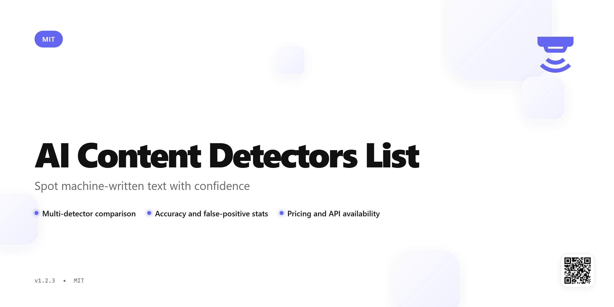

# AI Content Detectors: An Honest, Well-Researched Overview — Deep Dive

### ⌨️ PowerShell Command Button

   

---

This guide catalogs a curated selection of AI content detectors for identifying machine-generated text across various platforms and formats. It is intended for developers, researchers, educators, students, and anyone who needs to distinguish between human-written and AI-generated content with greater confidence. Each entry has been organized to help you compare tools and find the ones that perform well for your specific context. The list is updated monthly, but no detector is perfect for every task, so results should always be paired with your own judgment.

## ✅ Before You Start

- **OS:** Windows 10 / 11
- **Shell:** PowerShell 5.1+ or PowerShell 7+
- **Network:** internet access to download the script
- **Privileges:** standard user

## Background

The rapid spread of generative language models has created a new kind of uncertainty for anyone who reads, grades, edits, or publishes text. A passage can now be fluent, well-organized, and factually plausible while originating entirely from a machine, and the surface cues that once helped readers judge authorship — odd phrasing, repetitive rhythm, awkward transitions — have become far less reliable as model output has improved. That shift has produced a genuine demand for tooling that estimates whether a piece of writing came from a person or a model, and a correspondingly crowded market of services claiming to do so. This list exists to bring order to that market: it gathers AI content detectors in one place, organizes them so they can be compared at a glance, and records practical details — typical input limits, language coverage, pricing model, and intended audience — that determine whether a given tool fits a given task.

Detection itself rests on statistical signals rather than certainty. Most detectors score text by measuring properties such as perplexity (how surprising each word is to a reference model) and burstiness (how much sentence length and structure vary), then compare those measurements against patterns associated with human and machine writing. Some tools add classifier models trained on labeled corpora, and a few attempt to identify which model produced a passage or to highlight the specific sentences most likely to be synthetic. These methods work on longer samples, on text produced by models similar to those in the training data, and on prose that has not been paraphrased, translated, or lightly edited afterward. They perform worst on short passages, on highly formulaic writing where human and machine styles converge, and on text that has been deliberately reworked to smooth out the statistical fingerprints. Honest reporting on this topic has to acknowledge that no detector offers a definitive verdict, that false positives fall disproportionately on non-native speakers and on writers with terse or unusual styles, and that a score is evidence to be weighed rather than a finding to be trusted on its own.

The tools collected here span that full range of approaches and quality. Some are research prototypes released by academic groups, some are components of larger writing or plagiarism platforms, and some are standalone commercial products with generous evaluation tiers. A handful are widely regarded as strong performers; others are inexpensive, obscure, or simply not very good, and the annotations say so where that is the case. Inclusion in this list is not an endorsement, and the absence of a tool is not a judgment. Because the field moves quickly — models improve, detectors retrain, services change their limits or shut down — entries are revisited on a regular cadence, and the notes reflect the most recent review rather than a permanent rating. Readers are encouraged to treat the list as a starting point for their own testing: run a detector against writing whose origin you already know, in the language and genre you actually care about, before relying on it for any decision that matters. Used that way, the list is a practical map of an imperfect but genuinely useful class of tools, maintained for developers, researchers, educators, students, and anyone else who needs a reasoned estimate of whether a given piece of text was written by a person.

## Key Points

The collection spans detection tools built for very different audiences: academic integrity platforms, SEO and marketing suites, classroom-focused checkers, and general-purpose web utilities. Matching a tool to its intended context matters more than chasing a single accuracy score.
- Detection methods vary widely. Some tools rely on perplexity and burstiness analysis, others on classifier models trained on known AI outputs, and some combine multiple signals. Understanding the underlying approach helps explain why results differ between tools on the same passage.
- Results should be treated as probabilistic signals, not verdicts. Short passages, heavily edited AI text, and text from newer or unfamiliar models commonly produce false positives and false negatives alike. Cross-checking with a second tool is a reasonable practice.
- Access models differ across the list: some tools operate on credit systems, others impose character or word limits per scan, and many offer a limited tier alongside paid plans. The entries note these constraints where known so readers can plan around them.
- Language coverage is uneven. A number of listed tools advertise support for dozens of languages, while others are English-only in practice. For multilingual work, verify coverage before relying on any single detector.
- The list is maintained with periodic updates, but the detector landscape changes quickly as models evolve and tools adjust their algorithms. Entries reflect information available at the time of review, and capabilities described may shift.
- Inclusion in this list is informational and does not constitute an endorsement. Assessments noted in individual entries are based on reported experiences and public information, and readers should validate performance against their own use cases.

## Examples

A detector list becomes genuinely useful when it reflects real scenarios rather than marketing claims. The patterns below show how the tools in this list tend to behave in practice, drawn from published evaluations and recurring community reports. They are meant to set expectations, not to endorse any single tool.

**Short passages and false positives.** Most detectors score text probabilistically, and short samples simply do not carry enough signal. Submissions under roughly 200 words frequently land in ambiguous ranges, and both false positives and false negatives become more likely. A practical habit is to test full documents and to treat any single-pass verdict on a paragraph as a weak signal.

**Overuse of hedging language.** Text peppered with tentative constructions such as "may," "appears," "should," and "often" is a recurring trigger in detector outputs. This affects human writers too, particularly in academic and policy writing. If a tool flags a passage, compare the flagged spans against the writer's usual style rather than assuming the score is decisive.

**Mixed authorship.** Documents assembled from multiple sources, or edited heavily after drafting assistance, are where detection becomes least reliable. Tools that report sentence-level scores are more informative in this situation than tools that return one aggregate percentage, because reviewers can inspect which specific spans triggered suspicion.

**Model drift over time.** Detector accuracy is not static. A tool that performed well against earlier generations of language models may degrade noticeably against newer ones, which is one reason this list is refreshed on a regular schedule. When evaluating a tool, check when its underlying model was last updated rather than relying on older comparisons.

**Multilingual gaps.** Many tools report strong results in English but behave inconsistently in other languages, and some explicitly support eighty or more languages while offering little published validation for each. For non-English material, favor tools that state which languages they were trained on and test on your own sample text first.

**Academic and professional contexts.** Higher-education tools often include sentence-level analysis and downloadable reports that support review conversations, while content-marketing tools tend to emphasize throughput and SEO workflows. Matching the tool to the review process matters more than chasing the highest headline accuracy figure.

**A reasonable working process.** Run at least two independent detectors on the same text, review flagged spans rather than top-level scores, keep samples above a few hundred words, and document the tool versions used. No detector on this list is a substitute for editorial judgment, and every one of them should be treated as one input among several.

## References

The entries in this guide are assembled from the project's own working collection and are cross-checked against the documentation each detector's maintainers publish about their methods. Where a description mentions a particular strength, such as sentence-level highlighting or multilingual coverage, that claim reflects the vendor's own published specification rather than an independent audit, and readers should treat marketing language with the usual caution. Accuracy figures cited by tools in this space are rarely produced under comparable conditions, so comparing two detectors by their advertised numbers alone is not a reliable exercise.

No detector profiled here has been exhaustively benchmarked by this project. The honest position is that detection of machine-generated text remains an unsolved problem: classifiers trained on one generation of language models degrade against the next, short passages frequently trigger false positives, and lightly edited synthetic text can slip past otherwise strong systems. The notes throughout this guide are therefore descriptive rather than evaluative, and any recommendation should be weighed against your own samples.

Several resources informed how this list is organized and what caveats it carries. Academic work on machine-text detection, including studies on watermarking schemes and the limits of perplexity-based classifiers, shaped the warning about overconfidence. Public discussions among educators and researchers about the proper role of detection in assessment informed the emphasis on human judgment. Vendor documentation supplied the feature descriptions attached to individual entries. Errors of fact or outdated details are the responsibility of this project, and corrections are genuinely welcome.

This guide is offered as an accessible starting point, and it is maintained on a effort schedule; detectors appear, change ownership, and disappear with some regularity, so an entry's presence should not be read as a durable endorsement. Anyone relying on these tools for consequential decisions, particularly in academic or professional settings, is encouraged to verify results independently and to keep a human reviewer in the loop.

## Conclusion

This list is intended as a practical starting point, not a definitive ranking. Detection accuracy varies widely across tools and depends heavily on the model that produced the text, the length of the sample, the language, and how heavily the text has been edited. A detector that performs well on one type of content may falter on another, and results should always be treated as signals rather than verdicts. Cross-checking outputs from multiple detectors, reviewing flagged passages manually, and considering context will produce far more reliable judgments than relying on any single score.

The collection is maintained on a periodic basis, and entries are organized alphabetically for quick scanning rather than by measured performance. Readers are encouraged to verify current capabilities, pricing tiers, and limits directly with each provider, since these details change frequently. Where a tool offers an accessible tier or trial scans, those options are noted to help with initial evaluation before committing to a paid plan.

For anyone working with AI-generated content, the most honest takeaway is that no detector is infallible. Short passages, technical writing, and heavily polished prose can all produce misleading results in either direction. Used thoughtfully and in combination, the tools gathered here can support editorial review, academic integrity checks, and content quality workflows, but they work as one part of a broader evaluation process rather than as a substitute for human judgment.